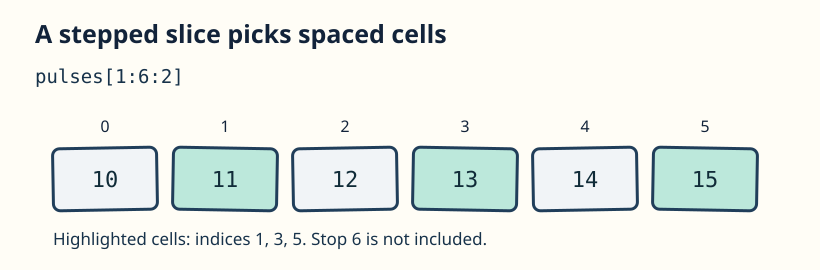

A meter records regular samples, but you only need every other one.

`a[start:stop:step]` includes `start` and excludes `stop`. In `pulses[1:6:2]`, start at index `1`, advance by `2`, and stop before `6`: you select indices `1`, `3`, and `5`. A slice leaves out any positions outside the array.

On the left of `=`, the slice chooses which original slots to change. One scalar value fills all those slots. The starter prints `window` before that assignment, so its first output shows the original selected values. A NumPy slice shares storage with its source; `window` itself also changes after the assignment. The views lesson will make that sharing visible.

## Your Task

1. Change the slice assignment from `0` to `-1`; Run shows which original slots changed.

Edit `main.py`, press **Run** to inspect the result, then **Submit** to check the change.
