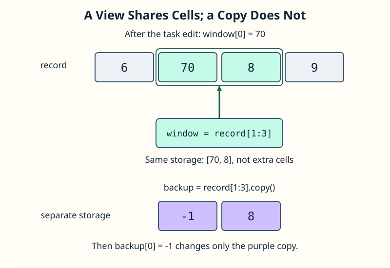

A slice can look like a smaller array while still using the original array's storage. For `record = np.array([6, 7, 8, 9])`, the slice `record[1:3]` covers the values `7` and `8`. Its index `0` refers to index `1` in `record`.

This slice is a **view**. Editing `window[0]` therefore changes `record[1]` too. `np.shares_memory(record, window)` checks whether they overlap in memory; it prints `True` for this nonempty slice.

The starter then calls `.copy()` to create `backup` after the view edit. That copy starts with the current values, but editing `backup[0]` leaves `record` alone. The second shared-memory flag is `False`.

A slice of a Python list creates a new list; a basic NumPy slice does not copy its values. Gathering with an index list or a Boolean mask does make a copy. Direct indexed assignment, such as `record[[1, 2]] = 0`, still writes into `record` itself.

## Your Task

1. Change the value assigned to `window[0]` from `99` to `70`.

Edit `main.py`, press **Run** to compare the two printed records, then **Submit**. Both printed records should contain `6`, `70`, `8`, and `9`: changing the backup did not change the record.
