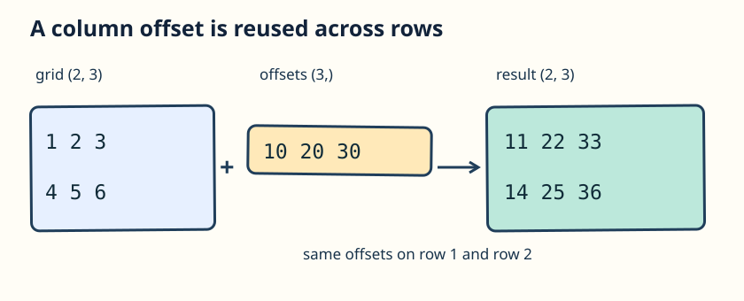

A sky grid needs a different correction for each column. You do not need to write a loop over its rows.

The grid has shape `(2, 3)` and `column_offset` has shape `(3,)`. **Broadcasting** compares shapes from the right. The final dimensions both have length 3; the missing leading dimension acts like length 1 and can expand to 2. NumPy reuses the offsets for both rows without requiring you to build a repeated array.

A `(3,)` array is one-dimensional, not a 2D row or column. Here it behaves like a row of three column offsets.

The diagram shows the starter's addition. Your edit subtracts the same offsets instead.

## Your Task

1. Change `+` to `-` in `adjusted`.

Run `main.py`: the first row becomes `[-9 -18 -27]` and the second `[-6 -15 -24]`. Then Submit.
