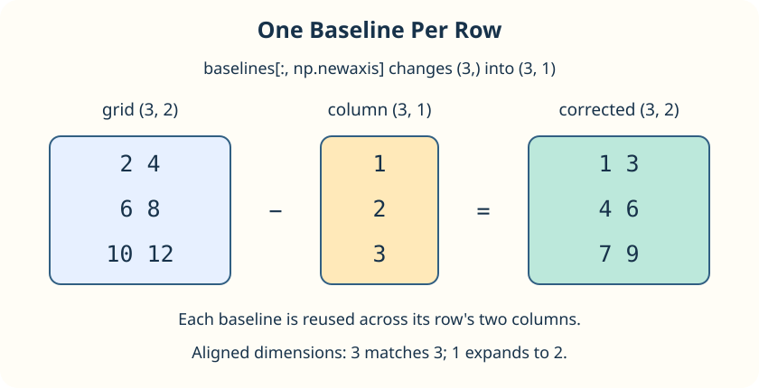

This time each row needs its own baseline. The grid has shape `(3, 2)`, while the three baselines start with shape `(3,)`. Those shapes cannot combine: their final lengths are 2 and 3.

`baselines[:, np.newaxis]` keeps all baseline values (`:`) and adds a new axis of length 1. The result has shape `(3, 1)`. Its three rows match the grid, and its single column broadcasts across both grid columns.

The diagram shows the subtraction you will make. Compare the two cases: `(columns,)` supplies one offset per column; `(rows, 1)` supplies one per row.

When aligned dimensions are neither equal nor 1, arithmetic raises `ValueError`. The supplied `try`/`except ValueError` demonstrates catching that error: Python skips to the `except` block if the addition fails, so the program can print a useful message instead of stopping.

## Your Task

1. Change `+` to `-` in `corrected`.

Run `main.py` to see the column shape `(3, 1)`, the corrected rows `[1 3]`, `[4 6]`, `[7 9]`, and the separate handled-error message. Then Submit.
