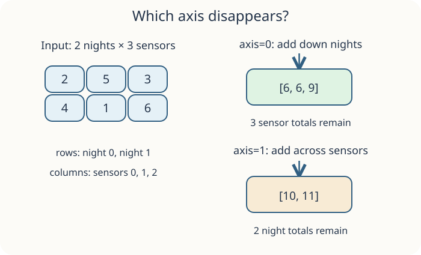

A grid has rows for nights and columns for sensors. `axis=0` collapses rows to give one total per sensor; `axis=1` collapses columns to give one total per night. Think **which axis disappears**: `axis=0` reduces the row dimension and retains columns; `axis=1` reduces columns and retains rows.

Run `main.py` first, make the small edit, then Submit.

## Your Task

1. Change the axis to `1` to print `[10 11]`, one total per night.
