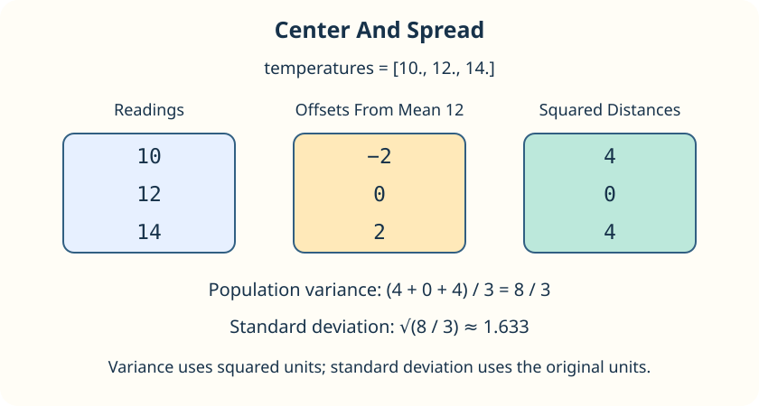

Two sensors can have the same average but fluctuate by different amounts. Use a measure of center alongside a measure of spread.

- `np.mean` adds the values and divides by their count.
- `np.median` finds the middle of the sorted values, or the average of the middle pair for an even count.
- `np.var` averages squared distances from the mean.
- `np.std` takes the square root of that variance, returning spread in the original units.

For `[10, 12, 14]`, the mean and median are 12. Distances from the mean are `[-2, 0, 2]`; their squares are `[4, 0, 4]`. Variance is `8 / 3`, and standard deviation is about `1.633`.

NumPy defaults to `ddof=0`: divide by the number of readings. We use this **population** calculation to describe exactly the values supplied, rather than estimating spread for a larger population.

## Your Task

1. Change `np.mean` to `np.std` in `spread`.

Run `main.py` to see approximately `1.633`, then Submit.
