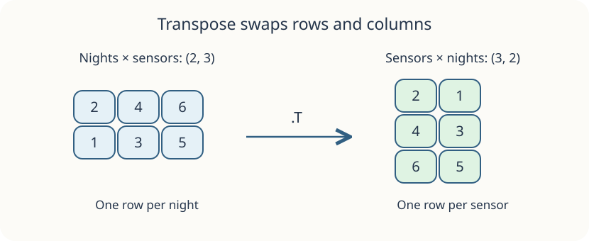

A technician wants to read one sensor per row instead of one night per row. Transposing a 2D array exchanges those roles: `.T` changes shape `(2, 3)` to `(3, 2)`, and the value at `[row, column]` moves to `[column, row]`.

This is not a rotation: the first row `[2, 4, 6]` becomes the first column, in that order. The original `grid` keeps its shape. A transpose can share its data, so it is not a way to make an independent backup.

Run `main.py` to see the starting shape. Change the right-hand side of the `turned` assignment, then Run and Submit.

## Your Task

1. Set `turned` to `grid.T` so the supplied print shows `(3, 2)`.
