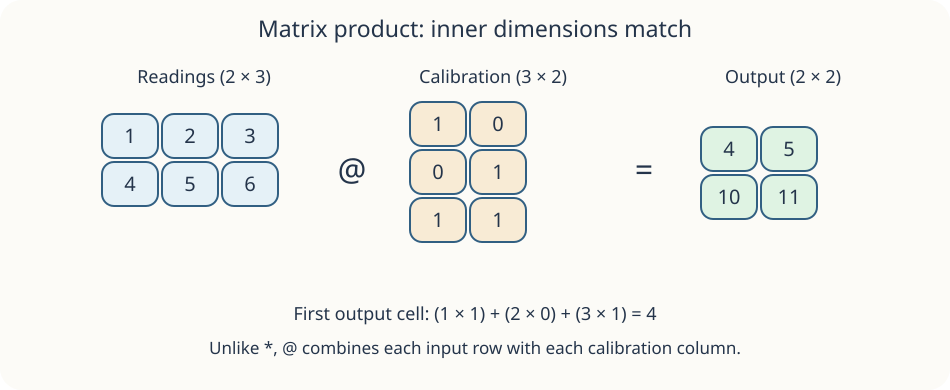

A calibration can combine several sensor readings into new channels. Matrix multiplication performs a dot product for every output cell: take one row from the left array and one column from the right array.

Here, `grid` has shape `(2, 3)` and `calibration` has shape `(3, 2)`. The matching inner dimensions tell us that each dot product has three pairs. The result keeps the outer dimensions, giving shape `(2, 2)`. If the inner dimensions differ, matrix multiplication raises a `ValueError`.

The first output cell is `1×1 + 2×0 + 3×1 = 4`. In Python, write this matrix operation as `grid @ calibration`; `np.matmul(grid, calibration)` is another spelling. Elementwise `*` does not combine rows and columns. The starter's `grid * 2` simply doubles every reading.

Run `main.py`, replace the expression assigned to `combined`, then Run again. The output should have two rows and two columns. Submit when you have checked both.

## Your Task

1. Set `combined` to the matrix product `grid @ calibration`.
