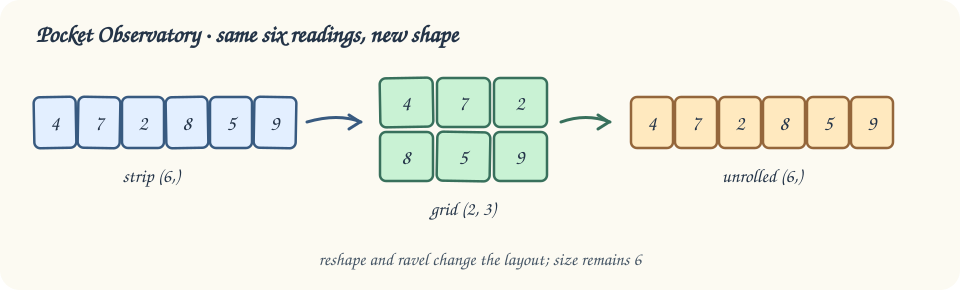

# Fold a signal

The previous panel already had rows and columns. This time, the Pocket Observatory receives six light readings in one flat strip. Arrange those readings into a card without adding or removing any.

`reshape` changes the dimensions while keeping the reading order. The starter's `signal.reshape(2, 3)` fills two rows of three, left to right. The product of the requested dimensions must equal `signal.size`; six values cannot fill a `(4, 2)` card.

The supplied `ravel()` call reads the card back into one dimension. Its default row-major order means it finishes one row before starting the next. Unlike transpose, reshape does not exchange the roles of existing rows and columns.

Edit the dimensions in `main.py`, then Run. Check that the card has three rows, its size is still 6, and the unrolled readings have not changed. Submit after that comparison.

## Your Tasks

1. Change the `card` reshape dimensions to `(3, 2)`, keeping all six readings in their original order.
