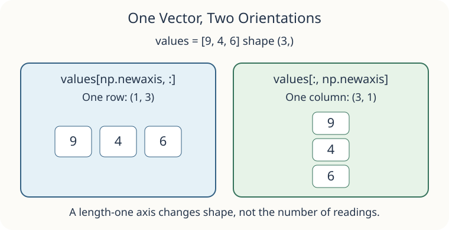

# Raise a new axis

A calibration value belongs beside each sensor row. A one-dimensional array with shape `(3,)` has no row or column orientation, and `.T` alone will not change that. You need to add an axis.

`values[:, np.newaxis]` keeps all three readings and inserts an axis of length one, giving shape `(3, 1)`. Put the new axis first instead, as in `values[np.newaxis, :]`, and the shape is `(1, 3)`. Neither expression duplicates readings.

The starter makes a row. Edit the indexing expression in `main.py`, then Run to see a column with the same three readings. Submit when its shape is `(3, 1)`.

## Your Tasks

1. Move `np.newaxis` after the slice in the `column` assignment to make a three-row column.
