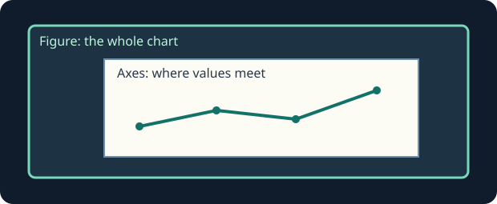

A garden volunteer wants a quick picture of three morning soil readings.

The **figure** is the whole chart; the **axes** is the plotting area inside it. `fig, ax = plt.subplots()` creates both. `ax.plot(...)` draws on that axes. The last reading is still a draft.

Edit `main.py`, press **Run** and inspect the chart, then **Submit** to check your change. If the chart looks unchanged, inspect the line or label named in the task.

## Your Tasks

1. Change the last soil reading from 12 to 16.
