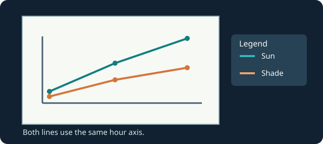

The garden tracks morning temperatures in a sunny bed and a shaded bed.

Call `ax.plot(...)` twice on the same axes. Each line needs a `label=`, and `ax.legend()` displays those names so readers can tell the lines apart.

Edit `main.py`, press **Run** and inspect the chart, then **Submit** to check your change. If the chart looks unchanged, inspect the line or label named in the task.

## Your Tasks

1. Change the second line label from `"Second bed"` to `"Shade"` while keeping both series and the legend.
