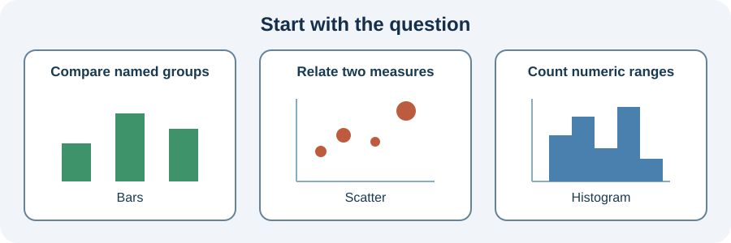

Garden beds have separate harvest totals.

Use `ax.bar(categories, totals)` when the horizontal positions are named groups and bar height is the quantity. The bars start at zero, so comparing heights is straightforward.

The starter already draws a figure. Make one small edit, then compare the visible chart. The function accepts new data, so the same chart works for other observations.

## Your Task

1. Change the bar color to `seagreen`.

Edit `main.py`, press **Run** to view the figure, then **Submit** to check your change.
