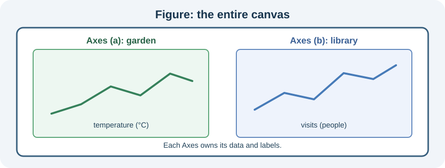

A library attendance line needs a wide space for day labels.

`figsize=(width, height)` sizes the Figure in inches. It changes the entire canvas, not the data coordinates.

The starter already draws a figure. Make one small edit, then compare the visible chart. The function accepts new data, so the same chart works for other observations.

## Your Task

1. Change the Figure size to `(8, 3)`.

Edit `main.py`, press **Run** to view the figure, then **Submit** to check your change.
