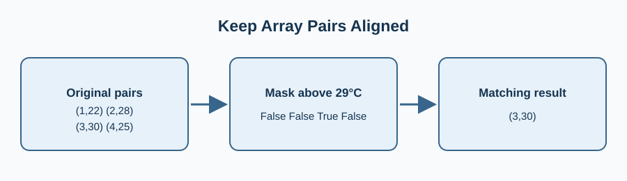

The garden desk only needs readings above a heat threshold. A Boolean mask selects matching days and temperatures together.

The two arrays must share a mask; filtering only the temperatures would pair them with the wrong days. Change the threshold from 27 to 29 and see the one remaining point.

Edit `main.py`, press **Run** to inspect the figure, then **Submit** to check the change.

## Your Tasks

1. Change `threshold` to 29 so the chart keeps only readings strictly above 29 °C.
