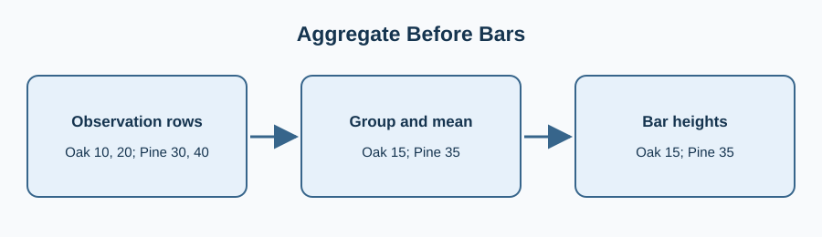

Several observations belong to each park. Compute the mean visitor count per park before drawing one bar for each group.

`groupby("park")["visitors"].mean()` reduces repeated rows to one value per category. Change the title so the chart describes the aggregation, not just the raw table.

Edit `main.py`, press **Run** to inspect the figure, then **Submit** to check the change.

## Your Tasks

1. Set the title to `Mean visitors by park`.
