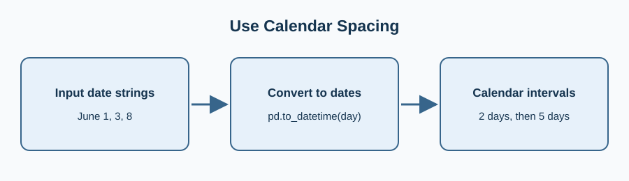

A street tree crew tracks watered trees on named dates. Convert the day column to real dates so the x-axis has calendar spacing, not text categories.

Convert with `pd.to_datetime`, then pass the dates and counts to `ax.plot`. Change the marker to squares to show each observation.

Edit `main.py`, press **Run** to inspect the figure, then **Submit** to check the change.

## Your Tasks

1. Change the plotted marker to `s` while keeping real calendar dates on the x-axis.
