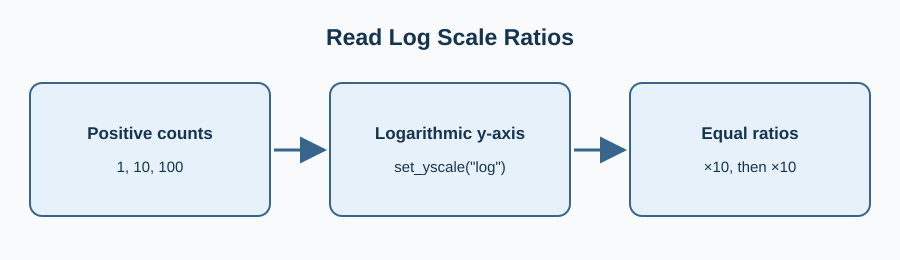

An event attendance series spans ones through thousands. A logarithmic y-axis can show multiplicative changes without flattening the smaller counts.

Log scales cannot place zero or negative values: do not use them to hide missing or invalid observations. Extend the lower bound from 2 down to 1 to show the first event.

Edit `main.py`, press **Run** to inspect the figure, then **Submit** to check the change.

## Your Tasks

1. Set the logarithmic y-axis lower bound to 1 and keep its upper bound at 1000.
