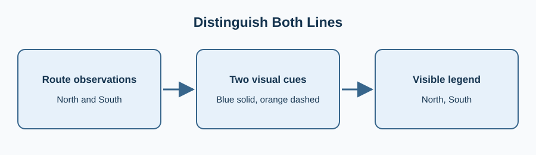

Two neighborhood pickup routes share one chart. Color and line pattern together distinguish them, and a legend names each route.

Use a temporary `ggplot` style context instead of changing every future chart. The second route currently shares the first route’s solid pattern; make it dashed.

Edit `main.py`, press **Run** to inspect the figure, then **Submit** to check the change.

## Your Tasks

1. Change the second line to a dashed `--` pattern while retaining both legend labels.
