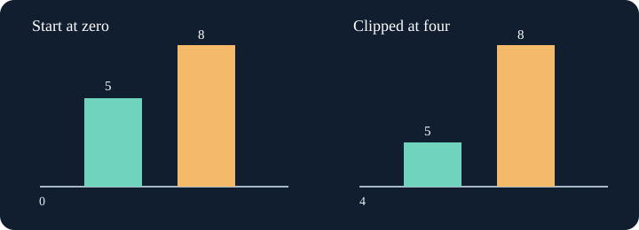

# Demo: Start bars at zero

The team compares five and eight garden volunteers. Bars encode magnitude by length, so a vertical axis beginning at four makes eight look many times larger. The bars in `main.py` already draw; change only the baseline and compare the before and after views. A line chart may use a zoomed range, but a magnitude bar needs its zero.

Edit `main.py`, press **Run** to inspect the figure, then **Submit** to check the change.

## Your Tasks

1. Set the bar chart lower y-limit to zero inside `draw_volunteers(counts)`.

