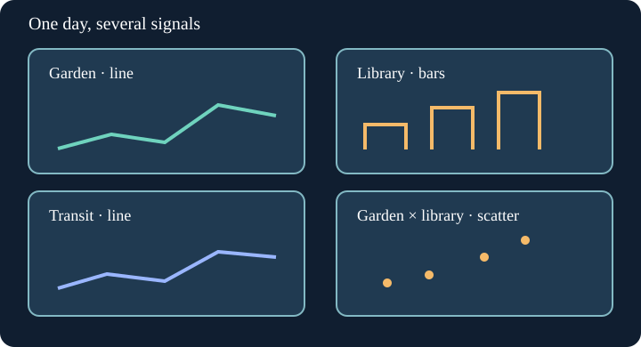

# Project stage 1: Lay out three signals

Plan four panels: garden trend, library branch totals, transit daily totals, and a fourth space for paired garden/library days. In this first stage the fourth panel is intentionally a labeled placeholder. Draw the library and transit panels using their DataFrames, rather than copying totals from the example. The diagram maps each question to one location.

Edit `main.py`, press **Run** to inspect the figure, then **Submit**. The checks also use different observations, not just the values shown here.

## Your Tasks

1. Fill the upper-right panel with grouped library branch bars; label visits and start its axis at zero.
2. Fill the lower-left panel with daily transit ride totals as a marked line and label both axes.

