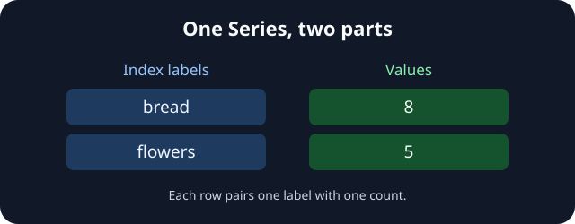

Welcome to the Community Data Desk. A volunteer has recorded 8 visitors at the bread stall and 5 at the flower stall. We need to keep each count beside the right name.

A **Series** holds one sequence of values with an **index**: the labels that identify those values. In `main.py`, `[8, 5]` supplies the counts and `index=["bread", "flowers"]` supplies their labels, in matching order. The import and printing code are ready for you; we will read the import in the next lesson.

Run the starter and read across each row. The picture shows that starting state. After your edit, the bread row should show `11`; the flowers row should still show `5`. The `dtype` line describes the stored values, not another stall.

## Your Task

1. Change the first value in `counts` from `8` to `11`, leaving the labels and the other count unchanged.

Edit `main.py`, use **Run** to see the new count, then **Submit** to check it.
