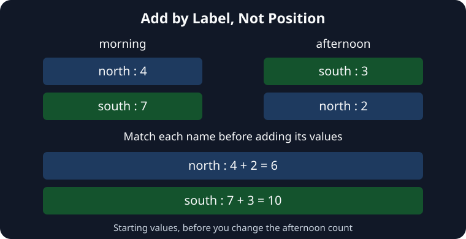

The morning volunteer listed `north` first; the afternoon volunteer listed `south` first. Adding their Series still combines the right places because pandas matches index labels before adding.

In the starter, north's total is `4 + 2 = 6`, and south's is `7 + 3 = 10`. Adding the first displayed values, `4 + 3`, would mix two different places.

A label found in only one Series has no partner. Ordinary addition leaves its total missing, often displayed as `NaN`, rather than guessing that the absent count is zero.

## Your Task

1. Change north's value in `afternoon` from `2` to `5`, leaving the other values and the addition in place.

Edit `main.py` and **Run**. North should now total `9`; south should still total `10`. Then **Submit**.
