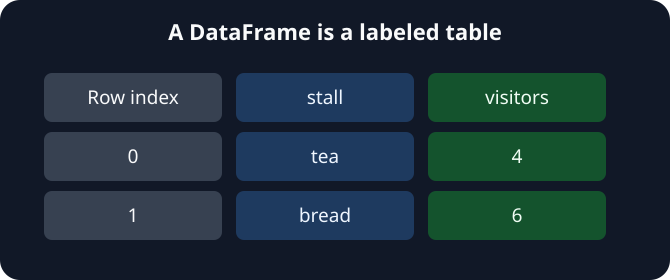

A Series gave us one sequence of counts. The desk now needs stall names and visitor counts together. A **DataFrame** is a table with an index for its rows and names for its columns.

The starter builds the same table in two ways. In `stalls`, dictionary keys become column names and each list supplies a whole column. Those lists must have the same length. In `records`, each dictionary supplies one row: its keys name the columns and its values fill that row.

The picture shows the starting values. Correct bread's count once in each input format. You can run and submit after the first correction; the second table can wait until task 2.

## Your Tasks

1. Change bread's visitor count from `6` to `9` in the column-based `stalls` table.
2. Change bread's visitor count from `6` to `9` in the row-based `records` table.

Edit `main.py`, **Run**, and compare the two printed tables. Once both show bread with `9` visitors, **Submit** checks each table separately.
