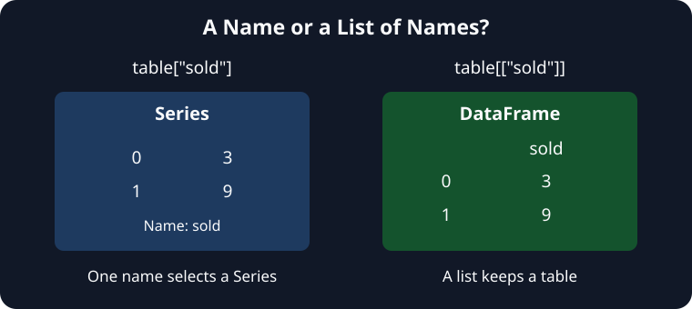

The desk needs sold counts on their own. Selecting `table["sold"]` returns that column as a Series, with the table's row index still attached.

A list of column names keeps the result as a DataFrame. In `table[["stall", "sold"]]`, the inner brackets make a Python list; the outer brackets select those columns. Even a one-name list, `table[["sold"]]`, returns a DataFrame. The difference is the kind of selector, not how many values the result contains.

## Your Task

1. Change `chosen` to select the `sold` column from `table` as a Series.

Edit `main.py` and **Run**. The first output should contain counts `3` and `9`, with `Name: sold` beneath them. The second output remains a two-column table. Then **Submit**.
