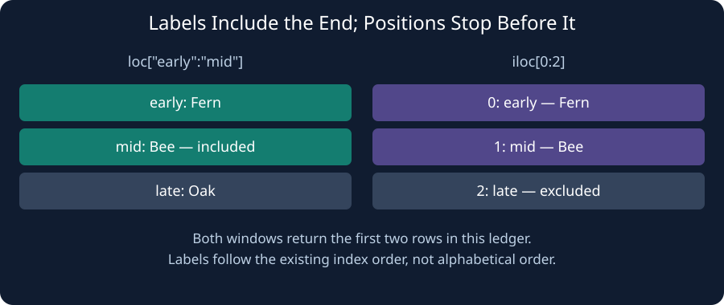

An event ledger uses named rows rather than plain row numbers. `.loc["early":"mid", ["stall", "sales"]]` selects labels and **includes** the ending label. `.iloc[0:2, 0:2]` selects row and column positions and **excludes** position 2. A label is not necessarily a row number.

The starter prints the position-based window and a label-based window. Change only the ending label in `result` to `"mid"` so both show two rows.

## Your Tasks

1. Change the `.loc` window to include the row labeled `mid`.

Edit `main.py`, press **Run** to inspect the table, then **Submit** to check your work.
