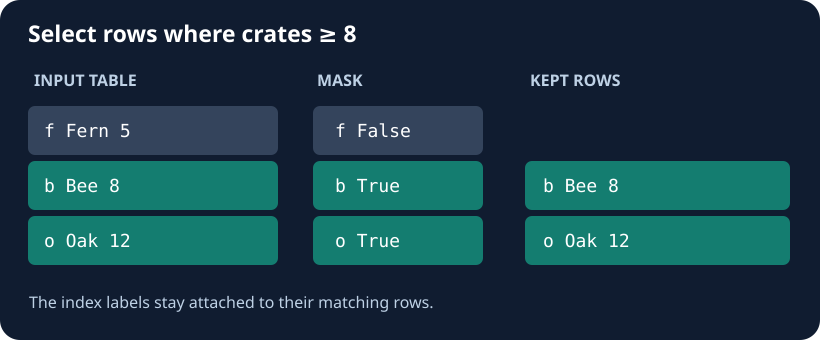

The desk only lists stalls with enough produce for the morning rush. `frame["crates"] >= 8` creates one True/False value per row. `frame.loc[mask]` keeps the True rows and their original labels.

Change the cutoff inside `select_stalls(frame)` from `5` to `8`; keep the rest of the code. It should also work on other stock tables.

## Your Tasks

1. Set the cutoff in the comparison to 8 crates.

Edit `main.py`, press **Run** to inspect the table, then **Submit** to check your work.
