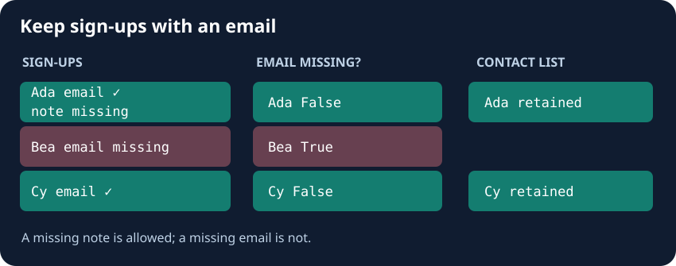

A row can exist even when one of its cells is missing. Before sending the contact list, the desk needs to distinguish a missing email from a missing optional note.

`signups.isna()` returns a table of Boolean decisions with the same shape. True means missing. Pandas recognizes markers such as None, NaN, and pd.NA; use isna rather than equality to test them. A blank string, "", is text and is not automatically missing. The way a missing cell prints can vary with its column dtype.

`dropna(subset=["email"])` returns rows where email is present. It does not require a note, or check whether an email is valid. Change the starter's subset from note to email. Run should retain Ada and Cy; Ada's missing note is allowed.

## Your Tasks

1. Require a non-missing `email` when creating `result`.

Edit `main.py`, press **Run** to inspect the table, then **Submit** to check your work.
