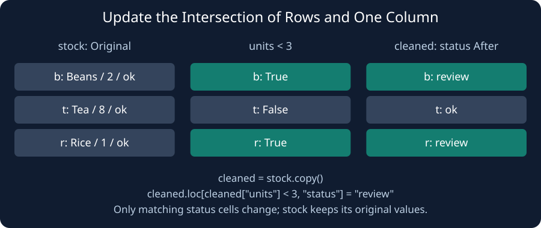

The supply desk wants to mark low-stock items while preserving its original record. `cleaned = stock.copy()` creates the table you will edit. The assignment must target cleaned itself.

`cleaned.loc[cleaned["units"] < 3, "status"] = "review"` gives Pandas the row mask and target column together. Only the cells at that intersection change. Rows with three or more units keep their existing status, and stock is untouched.

Do not split the update into selections such as `cleaned[mask]["status"] = ...`. That chained assignment targets a temporary selection, not the intended table; with Pandas 3 Copy-on-Write it does not update cleaned. The single loc assignment works across the versions used by this course.

Change the supplied value watch to review. Run should show Beans and Rice marked review while Tea stays ok.

## Your Tasks

1. Mark low-stock rows as `review` using the existing `.loc` assignment.

Edit `main.py`, press **Run** to inspect the table, then **Submit** to check your work.
