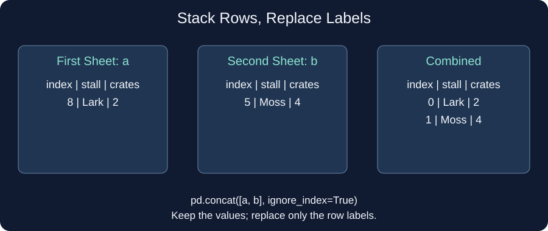

# Stack delivery sheets

The Community Data Desk has cleaned its delivery sheets. Now it needs one table containing both shifts. `pd.concat([a, b])` places the rows of `b` below those of `a`; the list gives their order. It matches columns by name, so keep an eye on spelling when combining real sheets. A column absent from one sheet gets missing cells for those rows.

The starter keeps the old row labels, 8 and 5. `ignore_index=True` replaces those labels with 0 and 1; it does not change the stall names or crate counts. Run before and after your edit and compare the leftmost labels.

Edit `main.py`, press **Run** to inspect the result, then **Submit** to check each task.

## Your Tasks

1. Change `ignore_index` to `True` in `stack_sheets`.
