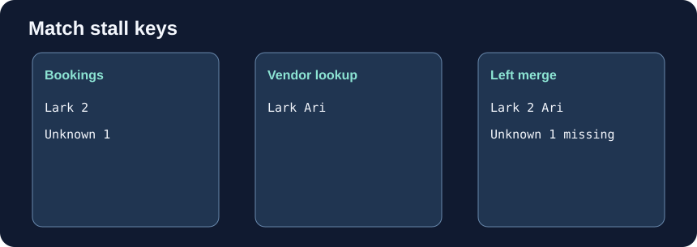

# Merge on a named key

Some bookings have no vendor record yet. An inner merge keeps only matched keys; a left merge retains every booking. Unlike column concatenation, merge compares values in a named column.

Edit `main.py`, press **Run** to inspect the result, then **Submit** to check your change.

## Your Tasks

1. Change `how="inner"` to `how="left"` in `attach_vendors`.
