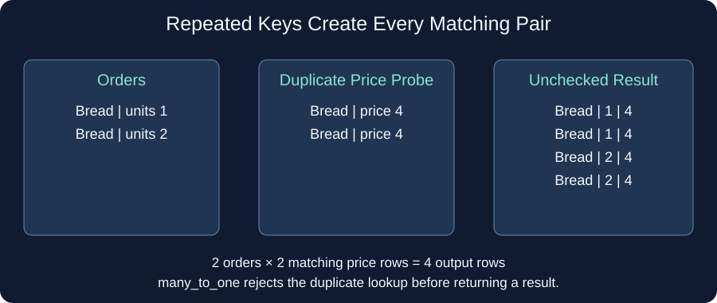

# Guard against duplicate prices

Two orders for Bread are legitimate: one customer bought 1 unit and another bought 2. The price lookup, however, should contain only one Bread row.

A merge pairs every left match with every right match. If Bread appeared twice in the price table too, each order would match both prices and the result would contain four Bread rows. This is called a many-to-many match. `validate="many_to_many"` allows it; it does not check uniqueness.

`validate="many_to_one"` allows repeated keys on the left but requires unique keys on the right. A duplicate price key then raises `pd.errors.MergeError` rather than returning an inflated ledger. `one_to_one` requires unique keys on both sides; `one_to_many` requires them on the left only.

The supplied preview also tries a duplicate price table and catches the error for you. After your edit, the normal ledger still prints, but the duplicate probe reports that it was rejected.

Edit `main.py`, press **Run** to inspect the result, then **Submit** to check each task.

## Your Tasks

1. Change `validate` from `many_to_many` to `many_to_one`.
