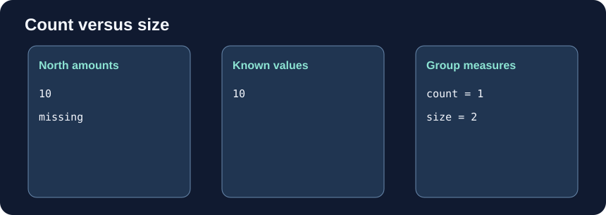

# Count values and rows

The desk compares receipts by zone. `mean` averages known amounts; `sum` totals them; `count` counts nonmissing amounts; `size` counts all rows. The printed fixture has one unrecorded amount.

Edit `main.py`, press **Run** to inspect the result, then **Submit** to check your change.

## Your Tasks

1. Change the second calculation in `zone_counts` from `count()` to `size()`.
