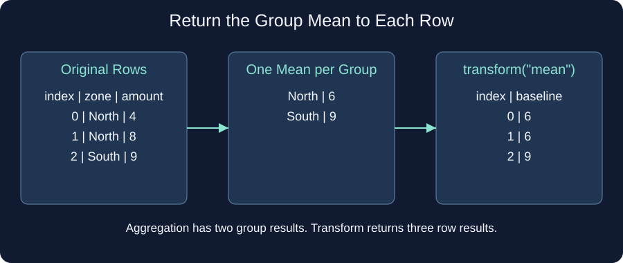

# Return a baseline per row

A summary gives one result per zone. This report instead needs a comparison value beside every original sale. `transform("mean")` calculates each group mean and repeats it at the rows that belong to that group. The returned Series keeps the original index and row order.

North amounts 4 and 8 have a mean of 6, so the first two rows both receive 6. South receives 9. The starter currently repeats the group sum, giving 12 for each North row. Change the operation and compare those two rows. You will subtract this kind of baseline in the next exercise.

Edit `main.py`, press **Run** to inspect the result, then **Submit** to check each task.

## Your Tasks

1. Change the operation in `zone_baseline` from `sum` to `mean`.
