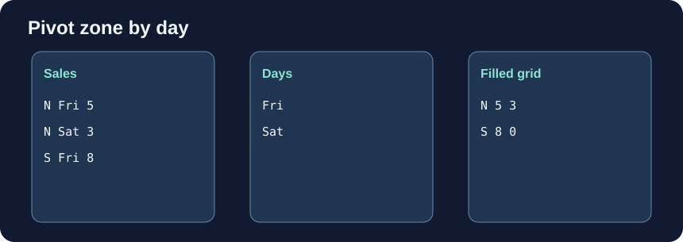

# Pivot a daily grid

The desk wants a grid: zones down the rows, days across the columns, and total amounts in the cells. `pd.pivot_table` accepts the source table followed by `index="zone"`, `columns="day"`, and `values="amount"`. Here index names the column whose values become output row labels.

`aggfunc="sum"` adds repeated zone-day records into one cell. It is explicit because the default operation is mean. Unlike `pivot`, which requires unique row-column pairs, `pivot_table` can aggregate duplicates. `observed=True` restricts categorical labels to those observed in the data; missing grouping keys are omitted by the default `dropna=True`.

The sample has no S/Sat record. Run the starter to find its missing cell, then add `fill_value=0` to display zero there. This fills gaps in the result, not in the source records. It does not prove that anyone recorded a zero sale.

Edit `main.py`, press **Run** to inspect the result, then **Submit** to check each task.

## Your Tasks

1. Add `fill_value=0` to `daily_grid`.

## Learn more

The pandas [pivot_table documentation](https://pandas.pydata.org/docs/reference/api/pandas.pivot_table.html) gives the full argument details and more examples.
