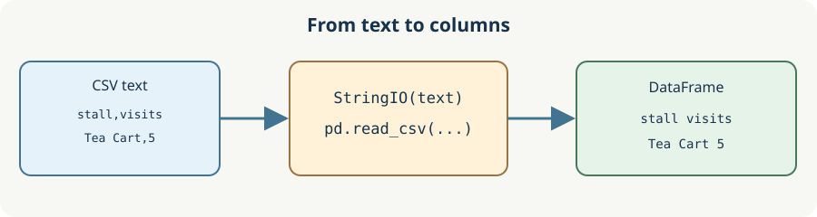

# Read a market CSV

The Community Data Desk can already summarize a table. Now the table arrives as text. **CSV** means comma-separated values: the first line names the columns, and each later line holds one row. In the sample, `Flower Cart,8` belongs under `stall,visits`. The `\n` characters in the Python string start new lines.

`from io import StringIO` imports a standard Python tool. `StringIO(text)` holds text in a **buffer**, an in-memory object that a reader can use like an open file. `pd.read_csv` reads that object into a DataFrame. Passing the raw string directly would make pandas look for a file with that name instead. Create a fresh buffer for each read; a reader advances through its contents.

The diagram follows the sample in `main.py`; no file is saved or downloaded.

The starter expects semicolons, so Run initially shows one combined column. Change only its `sep` argument to `","` in `main.py`, then Run again. You should see separate `stall` and `visits` columns. Submit checks another sheet too.

## Your Tasks

1. Make `load_visits(text)` return the two-column DataFrame read from the supplied comma-separated text.
