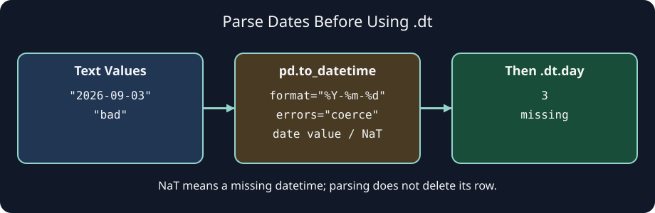

# Exercise: convert sign-up dates

A sign-up table is already loaded, but its `signed_on` column still holds text. You do not need to read the sheet again. `pd.to_datetime(a_column)` converts an existing Series; assign its result back to the column in a copy of the table.

Use an explicit `format="%Y-%m-%d"` for this desk's year-month-day dates: `%Y` is the four-digit year, `%m` the month, and `%d` the day. By default, an invalid value raises an error. With `errors="coerce"`, invalid or missing values become `NaT`, pandas' missing datetime marker. Coercion does not repair a date or delete its row. You can find these values with `.isna()` and decide later whether to correct or exclude them.

The diagram uses the first sample sign-up date and a separate bad-value example. An ambiguous date such as `03/04/2026` needs a known source format; do not guess whether it means March 4 or April 3.

Edit `convert_signups` in `main.py`. Work on `frame.copy()` so the caller still has the original text. Run to compare the two dtypes, then Submit. The returned table should keep all rows, including rows whose date becomes missing.

## Your Tasks

1. Implement `convert_signups(frame)` to return a copy with `signed_on` converted from year-month-day text to datetimes, coercing invalid or missing dates to `NaT` without changing the input.
