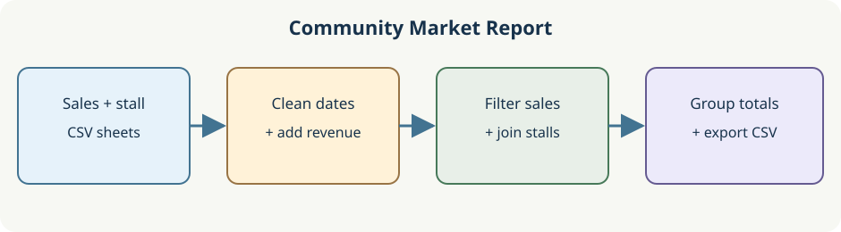

# Import the two market sheets

The market desk receives two small sheets. Sales identify stalls by `stall_id`; a separate directory names each stall and neighborhood. Keep the two inputs separate for now so each can be checked before a join. Both CSV strings are in memory; nothing needs downloading or saving.

Edit only `read_tables` at the bottom of `main.py`. Run to inspect the two table shapes, then Submit. This first milestone supplies the data that every later starter carries forward.

## Your Tasks

1. Implement `read_tables(sales_text, stalls_text)` to return `(sales_frame, stalls_frame)` by reading **each supplied string** with `StringIO` and `pd.read_csv`.
