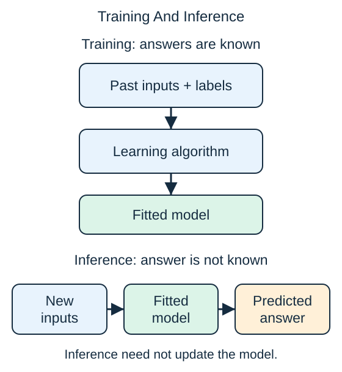

During **training**, a supervised learning algorithm examines features and known labels. It adjusts the model to improve its predictions on those examples. Some methods fit a small set of numbers; others retain examples or build many decision rules.

During **inference**, the fitted model receives features for a new case and makes a prediction. The actual answer is not an input to that prediction. For a delivery-time prediction, the inputs can include the distance and queue at dispatch; the actual duration is not known yet.

A prediction does not usually teach the model anything by itself. An observed outcome can later be recorded and included in a new training run. Until then, the deployed model may stay unchanged.

Keep both phases in mind when judging an input. An eventual refund may appear in historical delivery records, but it is unavailable at dispatch. A usable model must work with information available at the moment it predicts.

## Check your understanding

Does making a prediction necessarily update the model?

**Answer:** No. Ordinary inference applies the fitted model; updating it requires a separate learning step.
