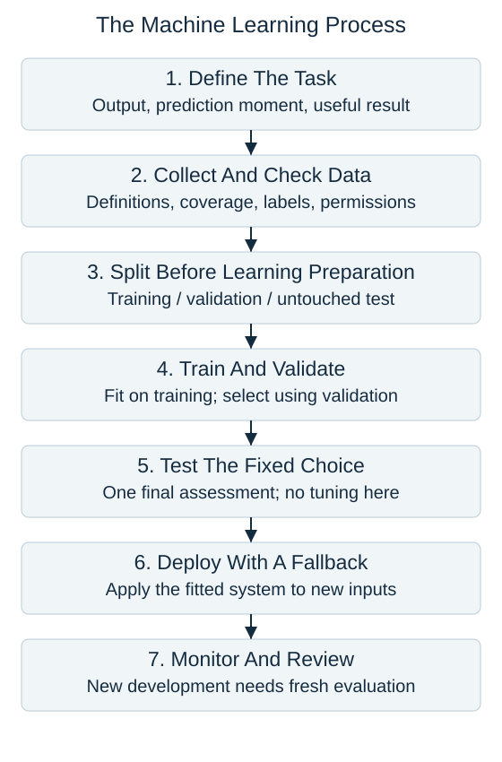

A machine learning project starts by defining a task: what output is needed, when the prediction is made, and how a useful result will be judged. Choosing an algorithm comes later.

Collect examples that represent the intended use, with consistent definitions and appropriate permissions. Establish the split before learning preparation rules from the data. For supervised learning, training examples provide both features and targets.

The three sets have different jobs. Training data fits preparation steps and model parameters. Validation data compares candidate settings and decision thresholds. Test data gives a final assessment after those choices are fixed. These terms receive fuller treatment in the evaluation section; for now, notice that the test set never guides the training-and-selection loop.

A candidate includes more than an algorithm name: its feature choices, learned preparation, and decision rule all affect the result. Keep those steps together when evaluating it. A valid comparison applies each candidate to the same held-out examples using measures tied to the task.

Deployment applies the chosen system to new inputs. Monitoring checks whether inputs, errors, or operating conditions change. Outcomes can motivate a later development cycle, but repeatedly adapting to one test set destroys its independence. A new cycle needs suitable fresh evaluation evidence.

The arrows show responsibilities, not a promise that every project reaches deployment. Poor data or an inadequate benefit over a simple rule can justify stopping earlier.

## Check your understanding

At what point should a final test set influence the choice of tree depth?

**Answer:** It should not. Use validation data for that choice, then evaluate the fixed system on the test set.
