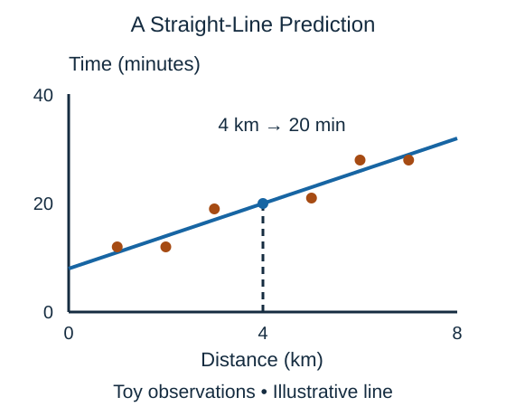

For a prediction of duration from distance, **linear regression** fits a straight-line relationship when there is one numerical feature. Fitting chooses a slope and a starting level that make the observed errors small overall; the line need not pass through every trip.

$$
\hat{y}=wx+b
$$

Here $\hat{y}$ (read "y-hat") is predicted time in minutes, $x$ is distance in kilometers, $w$ is the added minutes per kilometer, and $b$ is the starting number of minutes. The hat marks an estimate rather than an observed answer.

For an illustrative model with $w=3$ and $b=8$, a trip of $x=4$ kilometers gives $\hat{y}=3\times4+8=20$ minutes. The starting time might reflect pickup work, although the equation alone does not prove that explanation.

With more features, the model adds several weighted contributions. It remains a useful simple comparison model. A straight relationship can miss rush-hour effects, and extending it far beyond the distances seen in training is risky. Prediction is not proof that changing one feature causes the predicted change.

A common fitting objective is the sum of squared differences between observed and predicted targets. The algorithm selects weights to reduce that objective on the training examples. Minimizing training error is not the same as demonstrating useful error on new inputs; the evaluation section separates those questions.

## Check your understanding

Must every observed trip sit on the fitted line?

**Answer:** No. The line summarizes a relationship; individual observations can differ.
