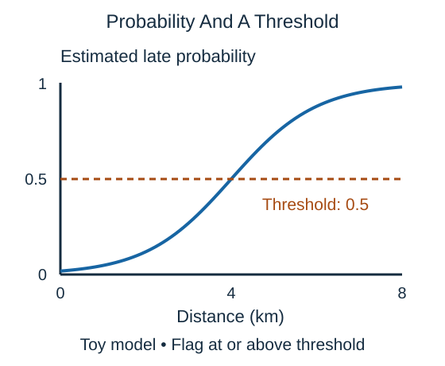

Despite its name, **logistic regression** is commonly used for classification. For a binary task, it turns a weighted combination of features into an estimated probability between zero and one.

A classifier might estimate a 0.7 probability that a delivery will be late. That is a forecast, not a promise that this particular trip will be late. A **threshold** turns the estimate into a decision: flag the trip if its estimated probability is at least 0.5, for example.

A lower threshold flags more trips. It can catch more late arrivals, but it can also warn about trips that would arrive on time. The appropriate threshold depends on the cost of each error; it need not be 0.5.

Logistic regression learns the relationship from labeled examples. On the original numerical features, its usual decision boundary is linear: a cutoff with one feature, a line with two, or a flat boundary with more. The probability curve can still be S-shaped. Adding carefully designed features can change which patterns that model can express.

## Check your understanding

With a 0.6 warning threshold, would an estimated late probability of 0.7 trigger a warning?

**Answer:** Yes. The estimate is at least the chosen threshold; it still does not guarantee lateness.
