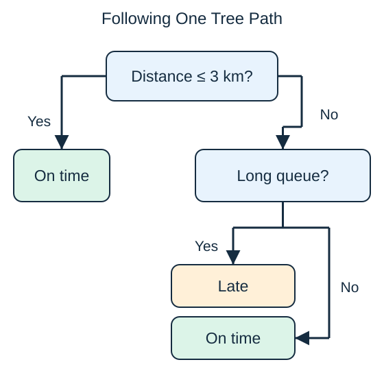

A **decision tree** makes a prediction by following questions from a starting node to an endpoint, called a leaf. Each question splits the cases into branches. A training algorithm chooses splits that make the resulting groups more useful for prediction.

Follow the toy tree for a 5-kilometer trip with a short queue: the distance answer is no, then the queue answer is no, so the prediction is on time. The thresholds are invented to explain the mechanism, not fitted evidence about delivery performance.

A classification leaf can predict the common label among training examples reaching it. A regression leaf can predict their average numerical target. The same question-and-branch idea supports both tasks.

A shallow tree is often easy to inspect. A deep tree can create tiny groups that reflect accidents in the training records rather than reliable patterns. Limiting depth or requiring more examples in each leaf can reduce that risk. Even a readable tree is not automatically a causal explanation: its questions describe predictive associations.

Training selects both which feature to ask about and the cutoff value. Prediction only follows the learned path; it does not search for new splits. A tree with one split is sometimes called a decision stump. The later classification demonstration deliberately uses one split so its mistakes are easy to inspect.

## Check your understanding

Does a tree need to ask every question in the diagram for each case?

**Answer:** No. It follows only the branch selected at each question until it reaches a leaf.
