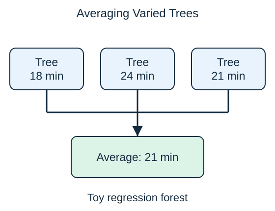

A **random forest** combines many decision trees. Each tree trains on a randomly sampled set of training rows, usually sampled with replacement. That means a row may appear more than once. Each split also considers a random selection of features.

These choices encourage the trees to differ. If all trees made exactly the same mistakes, combining them would add little. A forest averages numerical predictions for regression. For classification, implementations may combine votes or average class probabilities before choosing a class.

Our toy regression forest predicts 21 minutes by averaging 18, 24, and 21. One tree's unusually high estimate has less influence on the combined result than it would alone.

Forests often make predictions less sensitive to peculiarities of one training sample than a single deep tree. They do not remove bad labels or unrepresentative data. They also cost more memory and computation, and explaining hundreds of trees is harder than tracing one short path. A forest is a useful candidate, not an automatic upgrade for every problem.

Averaging is most helpful when errors are not perfectly aligned. Randomness encourages diversity but cannot create information absent from every tree. If all training records exclude an important condition, adding more trees does not supply examples of that condition.

## Check your understanding

Would averaging many identical trees correct their shared mistake?

**Answer:** No. The same error would appear in every prediction; useful diversity is part of the reason forests help.
