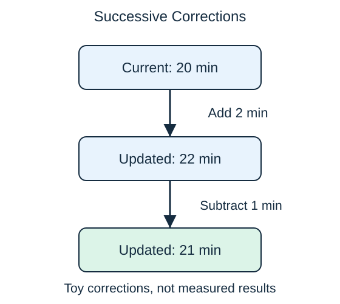

**Boosting** builds a collection of models in sequence. Each new model addresses weaknesses in the current combined prediction. Small decision trees are a common building block.

For an intuitive regression example, suppose the current estimate is 20 minutes and a later small tree contributes a correction of 2 minutes for trips with long queues. The updated estimate becomes 22 minutes. A subsequent tree can add another small adjustment. Real training chooses corrections by how they improve a defined error measure across examples, not by manually fixing one trip.

This differs from a random forest: forest trees are trained largely independently, while boosting steps depend on the current ensemble. Different boosting methods define "weakness" differently. Some emphasize misclassified cases; gradient boosting builds corrections tied to an error objective.

Many steps or large corrections can fit noise as well as useful patterns. A learning rate controls the size of the added corrections. Teams compare these settings on separate validation examples rather than assuming that more steps must improve future predictions.

The final prediction uses the combined model, not just the last tree. A learning rate and the number of steps work together: smaller updates may need more steps. Compare complete settings using validation data and keep final test outcomes out of that search.

## Check your understanding

Which approach fits the description "each new model responds to the current ensemble": a random forest or boosting?

**Answer:** Boosting. Its sequential dependence is the distinction in this comparison.
