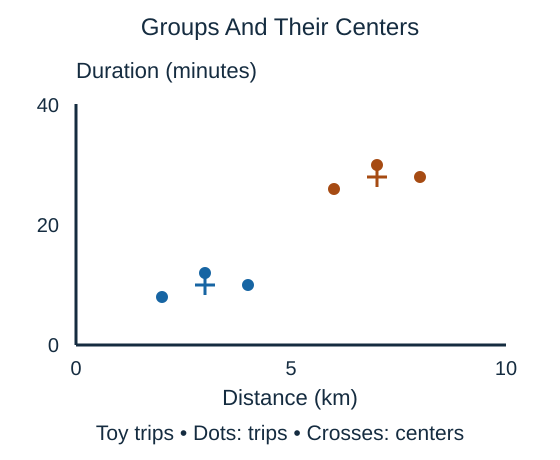

**Clustering** groups examples by similarity without being given the target categories to predict. It is an unsupervised learning task. With two numerical features, you can inspect the resulting groups as colored points in a scatter plot.

Each dot represents one example. Nearby dots have similar feature values under the chosen distance rule. A cluster label such as 0 or 1 names a discovered group; it is not a verified category supplied by the data.

This illustrative plot has two compact groups. The crosses summarize their centers; they are not additional observations. The next lesson shows how k-means can calculate such centers through repeated assignment and averaging.

A grouping depends on the features, scaling, and algorithm. Grouping by distance and duration asks a different question from grouping by time of day and package weight. Some algorithms require a chosen number of clusters; others can identify irregular groups or mark isolated observations as noise.

A visually separated group is not automatically a meaningful category. Clustering can support exploration and suggest patterns to investigate, but interpretation requires evidence beyond the plot. Check whether groups remain useful and reasonably stable under plausible changes to the data or modeling choices.

## Check your understanding

Does finding two clusters establish that there are exactly two natural categories?

**Answer:** No. The groups depend on the representation and method.
