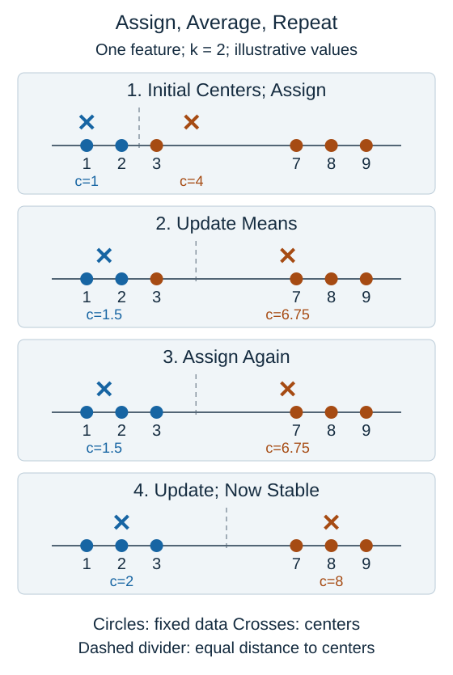

**K-means** represents a dataset with $k$ cluster centers, also called centroids. Here $k$ is the chosen number of groups. It alternates between assigning examples to centers and updating those centers.

Begin with initial center positions. Assign each example to its nearest center. Then replace each center with the coordinate-wise mean of the examples assigned to it. Repeat the assignment and update steps until the centers or assignments stop changing substantially.

Read the panels from top to bottom. Filled circles are observations; crosses are centers. The numbered point 3 changes group after the first center update. The data points do not move: only their assignments and the center positions change.

For one feature, a center is an ordinary mean. For values 1, 2, and 3:

$$
c=\frac{1+2+3}{3}=2
$$

Here $c$ is the center's coordinate. With two features, calculate the average of each feature separately. A center can lie between observations and need not be an actual recorded example.

K-means seeks small squared distances from examples to their assigned centers. Each assignment or mean update cannot increase that objective in the standard algorithm, but the final solution can depend on the initial centers. Different starts can settle into different groupings. Repeated starts help search for a better result; they do not guarantee the best possible grouping.

## Check your understanding

In an update step, do the recorded examples move toward their center?

**Answer:** No. The examples stay fixed; the center moves to their mean.
