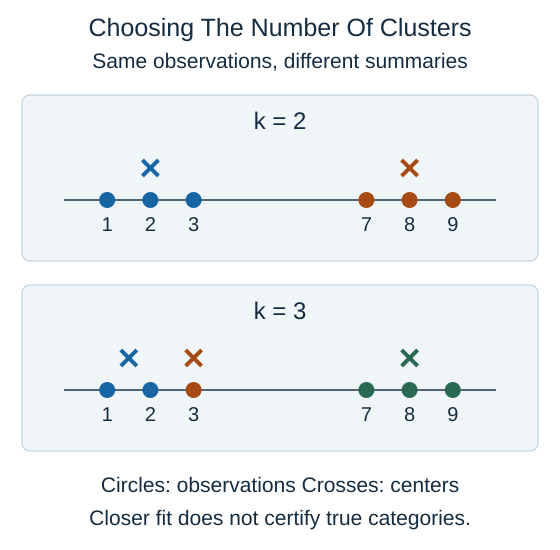

The number of clusters $k$ is a modeling choice, not an answer that standard k-means discovers automatically. Here $k$ counts the centers used to summarize the observations.

Read the two panels as alternative summaries of the same points. More centers can reduce the total squared distance to assigned centers. In the extreme, one center per distinct point can make that distance zero. A smaller distance therefore does not by itself prove that the grouping is more useful.

A plot of this distance against $k$ may show an elbow: a point after which additional centers make smaller improvements. Many datasets have no clear elbow. Compare plausible choices using the intended purpose, stability across samples or initializations, and whether the groups are interpretable without inventing unsupported labels.

Scale changes the distance calculation. If one feature is measured in thousands and another in fractions, the first may dominate even when it is less informative. Appropriate scaling makes the numerical comparison more deliberate; it does not guarantee meaningful groups.

K-means tends to favor compact groups under its distance rule. Curved groups, outliers, or very unequal spreads can produce misleading results. A separate plot, another clustering method, or deciding not to assign hard groups may be more appropriate.

## Check your understanding

Does a lower within-cluster distance after increasing $k$ prove that more true categories exist?

**Answer:** No. Extra centers can fit the same points more closely without adding meaningful categories.
