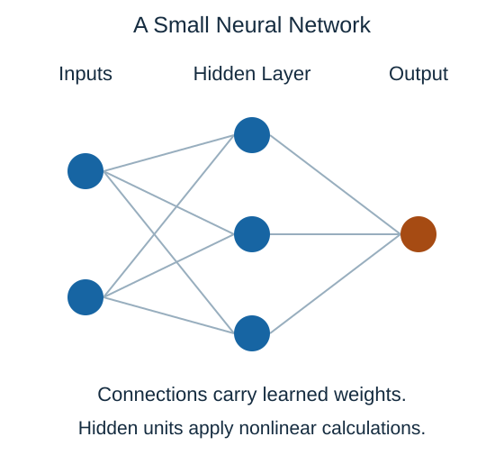

A **neural network** passes numerical inputs through connected layers of calculations. A unit combines incoming values using weights, adds an offset, and usually applies a nonlinear transformation. Nonlinear means the transformation is not just another straight-line rule.

The circles represent calculations, not biological cells. The input values enter the first layer. The hidden layer creates intermediate values, and the output layer produces a prediction. The lines show which values can contribute to each calculation; the diagram does not display the learned numerical weights.

During training, an objective measures how well the outputs meet the learning task. The training procedure adjusts weights to reduce that objective. With supervised examples, the objective compares predictions with the known targets. This is repeated across examples rather than manually assigning each connection a useful value.

Nonlinear transformations let the model express relationships a single linear combination cannot. Stacking only linear transformations still produces a linear relationship, even when many layers are used.

**Deep learning** uses neural networks with multiple layers that learn intermediate representations. Networks can support regression, classification, and other tasks; they are a model family, not a separate output type. More layers do not guarantee better results. Data, architecture, training choices, and independent evaluation still matter.

## Check your understanding

Does stacking only linear layers create a model that can represent arbitrary curved relationships?

**Answer:** No. Nonlinear transformations are needed.
