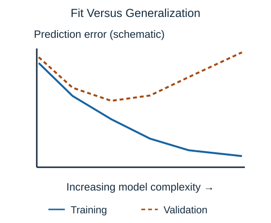

**Generalization** means performing usefully on new examples from the setting we care about. A model can do well on training records yet fail to generalize.

**Underfitting** occurs when the model or training procedure misses important patterns, so even training predictions are poor. A single constant time estimate may miss obvious differences between short and long journeys.

**Overfitting** occurs when a model follows training-specific details, including noise, that do not carry over. A very elaborate rule could explain every recorded delay but predict tomorrow's trips badly.

The chart is a schematic, not an experiment. Its message is the gap between improving fit to known examples and worsening results on separate validation examples. More complexity is useful only while it improves the behavior we need.

Limiting tree depth, reducing model size, or penalizing extreme weights can help. **Regularization** is the general idea of discouraging overly flexible or extreme fitted solutions. Its strength is a choice to evaluate, not a guarantee. Better, more representative data may help too, but collecting more copies of the same narrow cases does not solve every problem.

## Check your understanding

If training error falls while validation error rises, should you automatically keep the more complex model?

**Answer:** No. The pattern suggests overfitting; the improvement is limited to the training examples.
